<picture>
  <source media="(prefers-color-scheme: dark)" srcset="assets/banner-dark.svg">
  
</picture>

  
  
  
  

Full-stack engineer (TypeScript · MERN) who spends most days on the unglamorous half of GenAI: **what happens when the model is slow, rate-limited, down, or just wrong.** Every project here has a fallback chain, runs with zero API keys, and ships with tests.

**Right now at Myra AI** I'm building MCP OAuth integrations, MFA and session revocation for 500+ users, LLM model fallbacks, and an eval tool that replays conversations to see how persistent LLM memory drifts over time.

---

### 🔭 Featured work

<table>
<tr>
<td width="50%" valign="top">
<a href="https://github.com/SarthakJain29/MF-x-ray">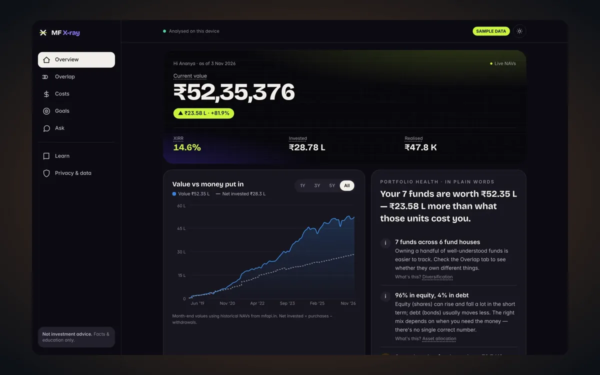</a>
<h4><a href="https://github.com/SarthakJain29/MF-x-ray">MF X-ray</a></h4>
See inside your mutual funds, privately. Drop in a CAMS/KFintech statement and get true XIRR, hidden fees and fund overlap. The PDF is decrypted and parsed <b>on your device</b>: no upload, no account.  
<code>Next.js</code> <code>pdf.js</code> <code>Web Workers</code> <code>PWA</code> <code>39 tests</code>
</td>
<td width="50%" valign="top">
<a href="https://github.com/SarthakJain29/News-shorts">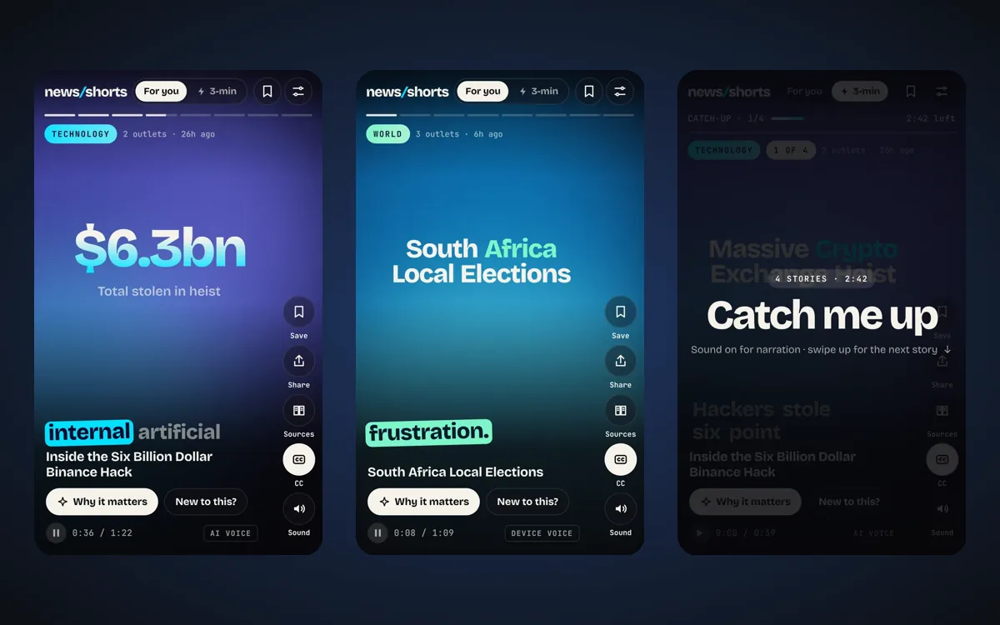</a>
<h4><a href="https://github.com/SarthakJain29/News-shorts">News Shorts</a></h4>
The news in 60-second swipes. A pipeline clusters 30+ feeds into stories, an LLM writes an original script (an originality guard rejects copied phrasing), and the browser renders narrated, karaoke-captioned explainers.  
<code>Next.js</code> <code>Gemini TTS</code> <code>d3-geo</code> <code>GitHub Actions</code>
</td>
</tr>
<tr>
<td width="50%" valign="top">
<a href="https://github.com/SarthakJain29/AI-code-review-bot">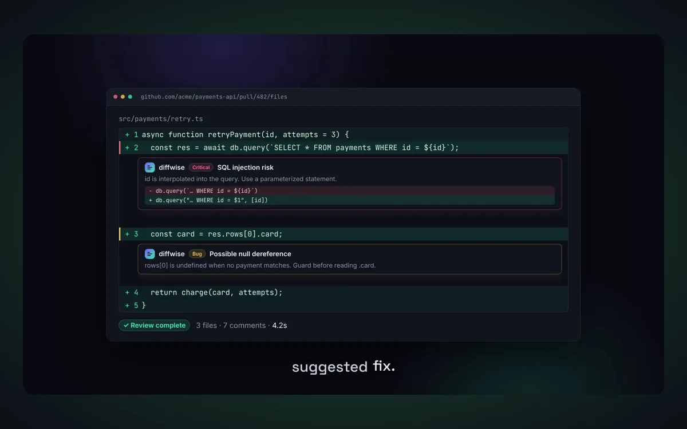</a>
<h4><a href="https://github.com/SarthakJain29/AI-code-review-bot">Diffwise Evals</a> 🚧 in progress</h4>
A scoreboard for AI pull-request reviewers, built <i>before</i> the bot. It mines 110 real bug-introducing PRs from Vue, Svelte, zod, axios and others (SZZ-style), then checks if a reviewer catches what maintainers later fixed.  
<code>TypeScript</code> <code>git blame / SZZ</code> <code>LLM-as-judge</code> <code>Wilson CIs</code>
</td>
<td width="50%" valign="top">
<a href="https://github.com/SarthakJain29/PDF_Chatbot">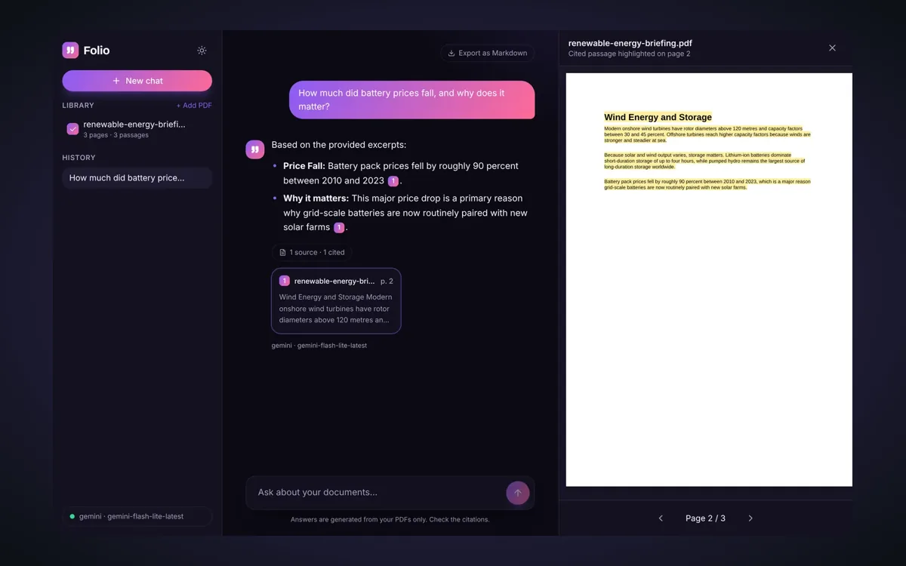</a>
<h4><a href="https://github.com/SarthakJain29/PDF_Chatbot">Folio</a></h4>
Chat with your PDFs and see the proof. Every claim cites the exact page, and clicking it highlights the passage. Parsing, chunking and BM25 retrieval all run in the browser.  
<code>RAG</code> <code>BM25</code> <code>IndexedDB</code> <code>Next.js</code>
</td>
</tr>
<tr>
<td width="50%" valign="top">
<a href="https://github.com/SarthakJain29/Similar-song-AI">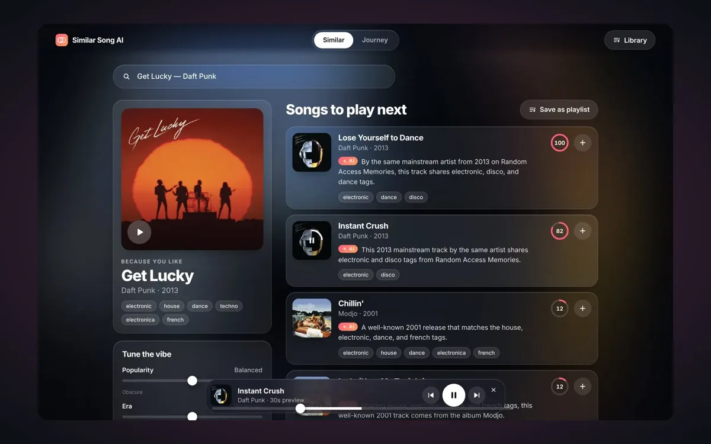</a>
<h4><a href="https://github.com/SarthakJain29/Similar-song-AI">Similar Song AI</a></h4>
Type a song you love and get what to play next, with <i>why</i>. Explanations are grounded in Last.fm data and validated, and anything unverifiable falls back to a deterministic sentence. Journey mode drifts from song A to B.  
<code>Last.fm</code> <code>Grounded LLM</code> <code>NDJSON streaming</code>
</td>
<td width="50%" valign="top">
<a href="https://github.com/SarthakJain29/Notes-Inbox-app">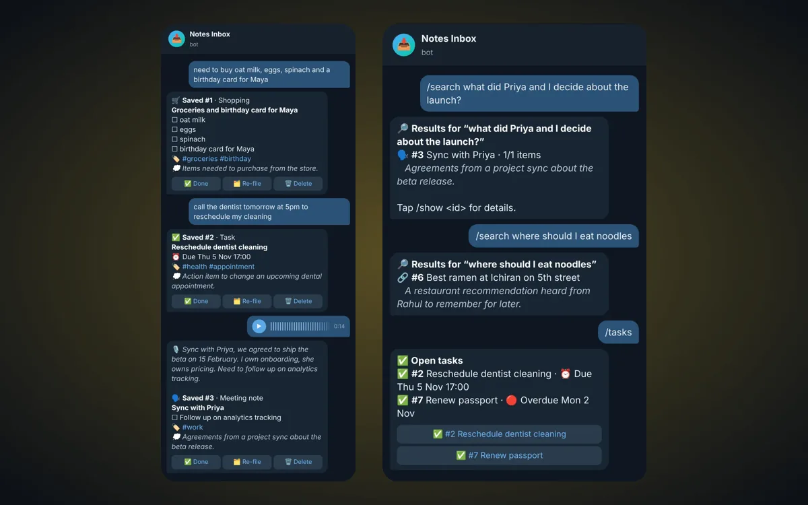</a>
<h4><a href="https://github.com/SarthakJain29/Notes-Inbox-app">Notes Inbox</a></h4>
Dump anything into Telegram, and AI files it: classifies, titles, tags, dates and reminds. It also searches by meaning. If the model is down, an offline classifier saves the note so nothing is ever lost.  
<code>grammY</code> <code>SQLite</code> <code>Embeddings</code> <code>~170 tests</code>
</td>
</tr>
</table>

<b>More things I've built →</b>

 

| | Project | What it does |
|---|---|---|
| 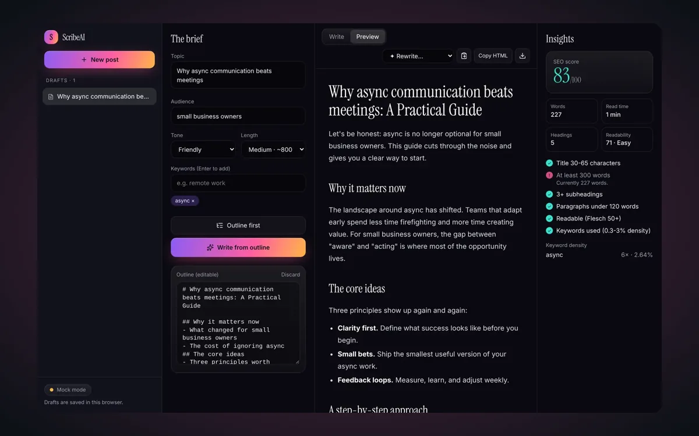 | [**ScribeAI**](https://github.com/SarthakJain29/AI-Blog-Generator) | Topic → SEO-aware blog post, streamed token by token, with live SEO and readability scoring. |
| 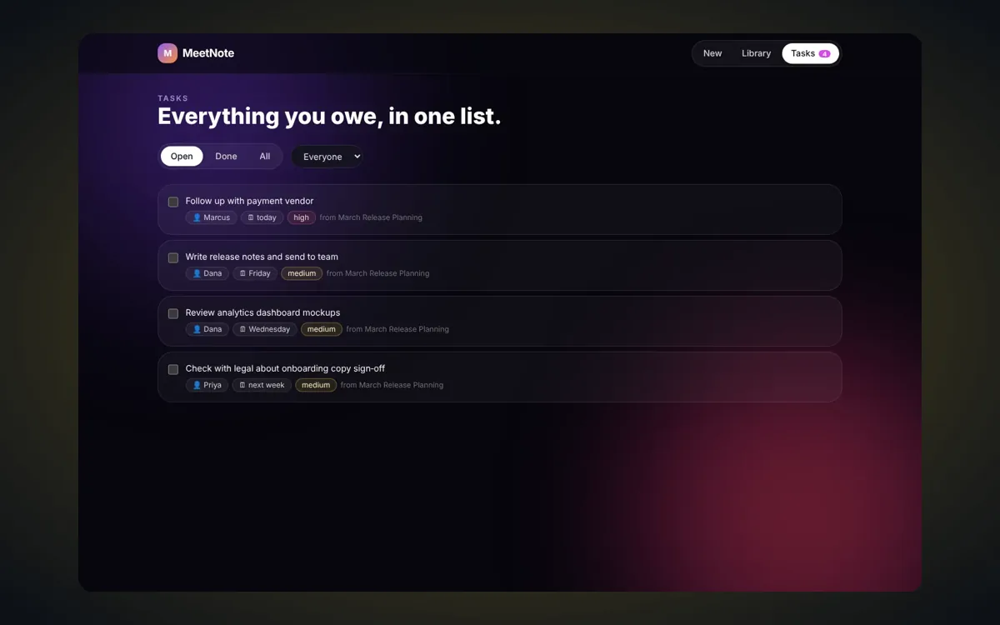 | [**MeetNote**](https://github.com/SarthakJain29/MeetNote) | Meeting transcript → summary, decisions and an owner-assigned task board. Schema-validated output. |
| 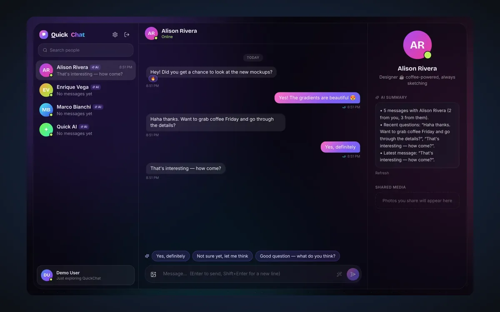 | [**QuickChat**](https://github.com/SarthakJain29/Quick-Chat) | Real-time Socket.IO chat with AI smart replies, summaries and tone rewrite. Runs with zero accounts. |
| 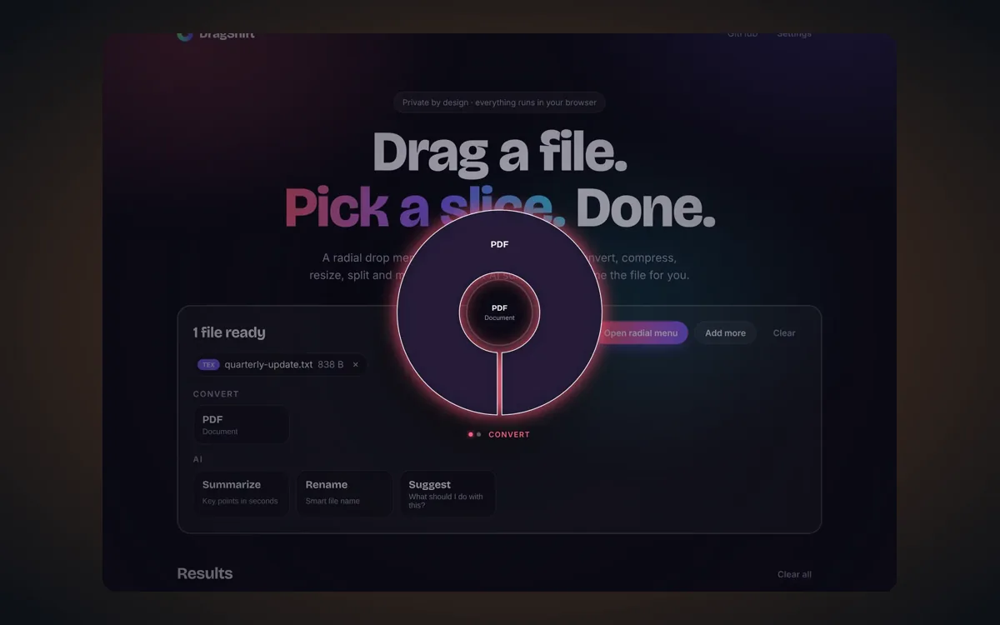 | [**DragShift**](https://github.com/SarthakJain29/DragShift) | Drag a file, pick a slice: a radial menu that converts, compresses and merges files entirely in-browser. |
| 🎬 | [**Demo-Videos**](https://github.com/SarthakJain29/Demo-Videos) | Narrated product videos for MF X-ray and Diffwise, made in code with Remotion. |

---

### 🧭 Path so far

- **Myra AI**, Software Engineer · *Jan 2026 – now*: MCP OAuth, MFA, Atlas Search infra, LLM fallbacks and evals
- **Protiviti**, Technology Consultant · *Jun 2024 – Dec 2025*: built a role-management tool with 45% faster data retrieval and REST APIs with 30% better performance (intern → full-time)
- **Bennett University**, B.Tech CSE · *2021 – 2025*: 9.07 CGPA, Smart India Hackathon 2023 finalist

### 🛠️ Toolbox

  

**GenAI:** Gemini · Groq · OpenAI · Vercel AI SDK · MCP · RAG · embeddings · evals / LLM-as-judge

---

  Building something with LLMs that has to work in production? <a href="mailto:sarthakjain3241@gmail.com">Let's talk.</a>

